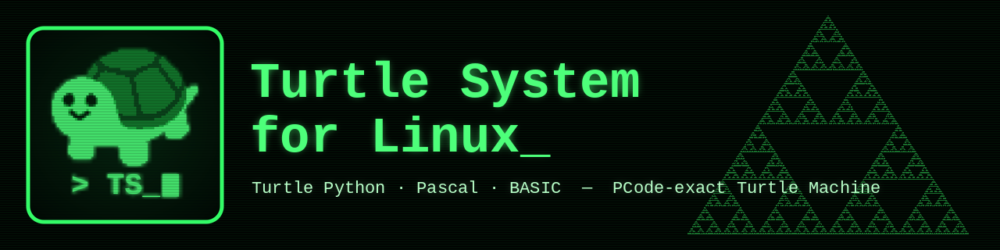
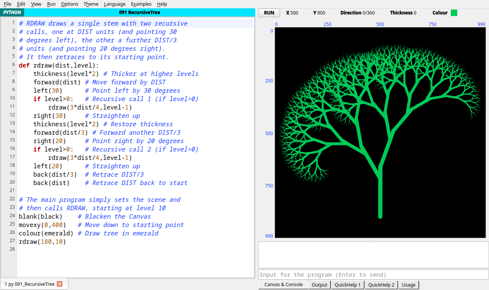
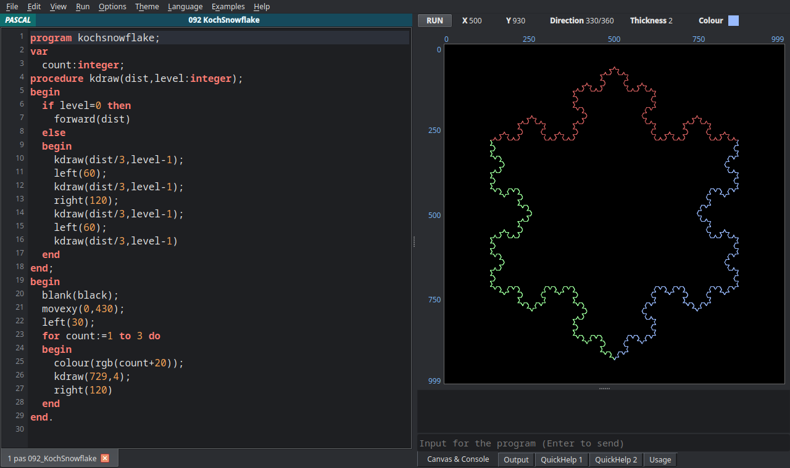
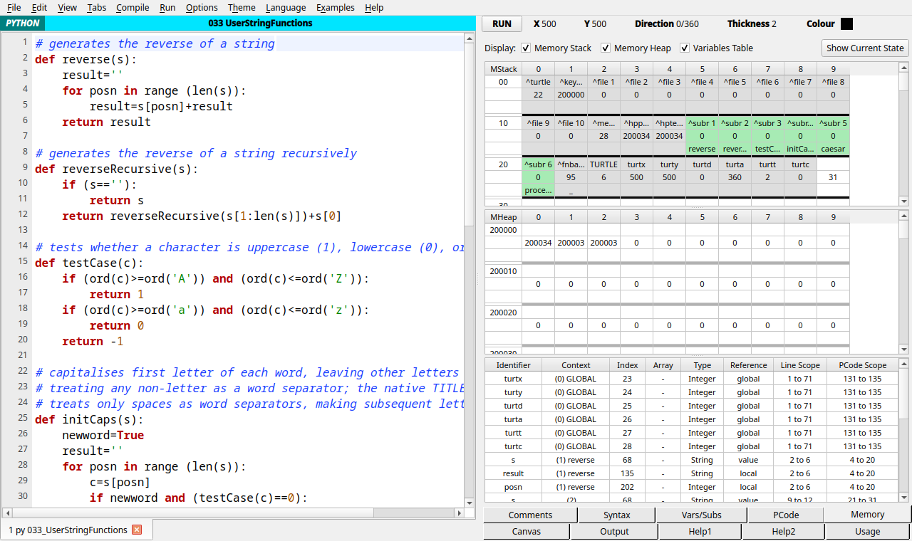
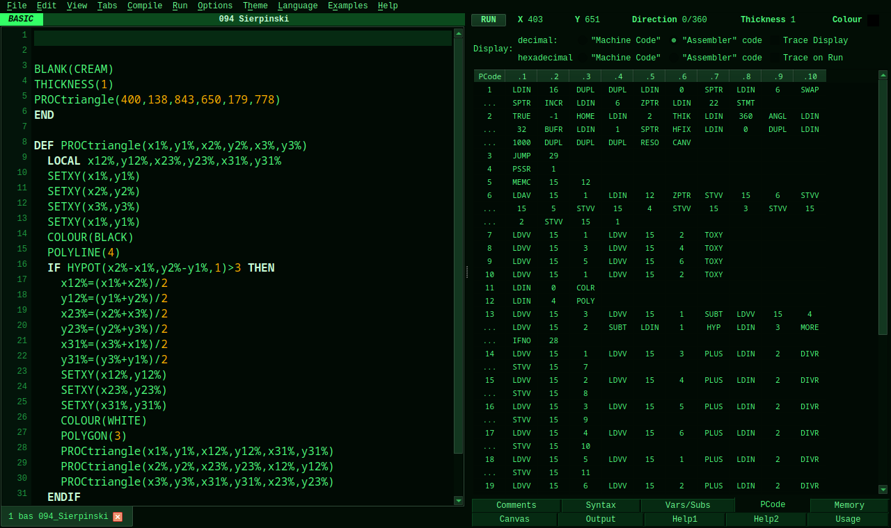

<p align="center">
  
</p>

<p align="center">
  
  
  
  
  
</p>

A native Linux re-implementation of **Turtle System 15.95** — Peter Millican's educational
programming environment (University of Oxford / National University of Singapore) — with
**Turtle Python**, **Turtle Pascal** and **Turtle BASIC**.

Programs are compiled to the original's **Turtle Machine PCode** and run on a re-implemented
Turtle Machine, so the Machine-mode tabs (PCode, Memory, Vars/Subs, Syntax) show the real
machine: its PCode, its memory stack and heap, cell by cell. The behaviour was verified against
the original program run under Wine as an oracle.

> Unofficial project, not affiliated with the authors of the Turtle System.
> The original Windows program is available from <https://www.turtle.ox.ac.uk/>.

## Screenshots

| Turtle Python | Turtle Pascal (dark theme) |
|---|---|
|  |  |
| **Machine mode: Memory** — stack, heap and variables of the Turtle Machine | **Machine mode: PCode** (Green terminal theme) |
|  |  |

## Features

- **Three languages** with the original's syntax and semantics: Turtle Python (Pascal-style
  operator precedence, `?key`/`\escape` input codes, lists), Turtle Pascal (strings, arrays,
  `var` parameters, nested routines) and Turtle BASIC (`%`/`$` variables, `DIM`, `DEF PROC/FN`,
  `LOCAL`, `RETURN` parameters).
- **PCode compilers** for all three languages, producing PCode identical to the original's
  (`.tmc`) for all 319 built-in examples, and a **Turtle Machine** (`tm/vm.py`) executing it:
  memory of 32-bit cells, heap strings, memory-control, return and subroutine-register stacks.
- **Pixel-exact drawing**: the Windows GDI rasterisation the original relies on (lines with
  wide pens, ellipses, polygons, flood fill) is ported from Wine's `dibdrv`; 80-bit
  extended-precision trigonometry and Delphi rounding and random numbers are reproduced.
  (Text drawn with `display` uses Linux fonts, so it can differ slightly.)
- **The original's interface**: Simple / Normal / Expert / Machine modes; Canvas, Output,
  QuickHelp, Usage, Comments, Syntax, Vars/Subs, PCode (with trace) and Memory tabs; detached
  and large canvas; multi-document editor with syntax highlighting, auto-format, find & replace.
- **All 323 built-in example programs**, grouped as in the original's Examples menu.
- **Extras**: 8 colour themes (incl. dark, high contrast, Solarized, Sepia, Green terminal),
  canvas zoom and pan (Ctrl + `+`/`-`, Ctrl + mouse wheel), optional black canvas with white
  pen, CSV/TSV export of every table, saving and loading PCode files.

## Installation

Requirements: Python 3.10+ (developed and tested with 3.14), PySide6 (Qt 6) and NumPy.

```sh
git clone https://github.com/PiotrKajor/turtle-system-linux.git
cd turtle-system-linux
pip install -r requirements.txt      # or: sudo dnf install python3-pyside6 python3-numpy
python3 turtle_system.py             # run
./install.sh                         # optional: menu entry, icons, .tgy/.tgp/.tgb file types
```

## Usage

| Key | Action |
|---|---|
| Ctrl+R / F9 | Run the program |
| Ctrl+H | Halt |
| Ctrl+P | Pause |
| Ctrl+T | Trace on run (PCode tab) |
| Ctrl+I / D / L | Integrated / detached / large (1:1) canvas |
| Ctrl + `+` / `-` / 0 | Zoom the program text, or the canvas when it has focus |

Choose **View → Machine Mode** to see the Syntax, Vars/Subs, PCode and Memory tabs.
Programs are saved as `.tgy` (Python), `.tgp` (Pascal) and `.tgb` (BASIC), compatible with the
original.

## How it is built

```
turtle_system.py     main window, editor, canvas, menus
tm/                  the Turtle Machine
  pylex.py, pycomp.py   Turtle Python  -> PCode
  pascomp.py            Turtle Pascal  -> PCode
  bascomp.py            Turtle BASIC   -> PCode (shares the Pascal code generator)
  vm.py                 the Turtle Machine (each PCode line compiled to a Python function)
  pcode.py, info.py     opcode table, .tmc files, program description for the tabs
runtime.py           canvas, turtle, input, files: the built-in command library
gdi.py               port of Wine's GDI rasterisation (pixel-exact drawing)
inspector.py         Usage / Comments / Syntax / Vars/Subs / PCode / Memory tabs
lang_*.py            source checkers (original error messages) and fallback engine
tools/               pcode_diff.py (compare with the original's PCode), extract_examples.py
```

### Verification

The original `TurtleSystem.exe` was run under Wine on a hidden X display and driven with
`xdotool`: probe programs wrote their results to files, canvases were captured at 1:1, and the
original's compiler saved PCode for every example. `tools/pcode_diff.py` compares this
system's PCode with those files:

```sh
python3 tools/pcode_diff.py ORACLE_DIR python   # 109 identical
python3 tools/pcode_diff.py ORACLE_DIR pascal   # 110 identical
python3 tools/pcode_diff.py ORACLE_DIR basic    # 100 identical
```

## Polski

Natywny klon systemu **Turtle System 15.95** dla Linuksa (Turtle Python, Pascal i BASIC).
Programy kompilują się do PCode identycznego z oryginałem i działają na odtworzonej maszynie
Turtle Machine; rysunki zgadzają się z oryginałem co do piksela. Uruchomienie:
`pip install -r requirements.txt && python3 turtle_system.py`.

## Credits and licence

- **Turtle System** and its example programs © Peter Millican (University of Oxford,
  National University of Singapore). The example programs in `examples/` are his work,
  included for educational use; see [NOTICE](NOTICE).
- Logo: built from Microsoft Fluent Emoji (MIT) and Google Noto Color Emoji
  (Apache 2.0) — see `logos/LICENSES.txt`.
- `gdi.py` is derived from Wine and is therefore under the LGPL 2.1 or later.
- The rest of the code: [MIT](LICENSE) © Piotr Kajor.
